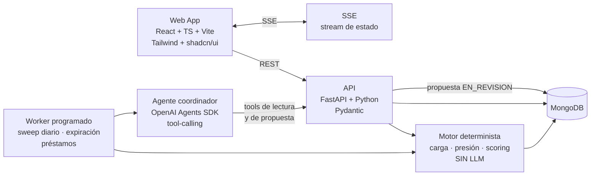

# DESIGN 0001 — Arquitectura

> Área responsable: arquitectura y plataforma · Estado: **cerrada por el cliente** (decisiones D-01..D-06 resueltas
> el 2026-10-21) · Secciones D-07, D-08 **abiertas** (pendientes de confirmación del cliente).
>
> Requisitos que debe cubrir: `US-01.*`, `US-02.*`, `US-03.*`, `US-04.*`, `US-05.*`.
> Restricciones heredadas de `specs/0001-vision/spec.md` §8 y `designs/0002-modelo-datos.md`.

---

## 0. Decisiones cerradas por el cliente

> *"web unicamente … react+TS+Vite, fastapi, python + mongo; los agentes dentro de la solución,
> será con el estandar Open IA"*

Estas decisiones **no son opinión de las áreas de trabajo**: son la instrucción del cliente. Las decisiones
técnicas que quedan abajo se derivan de ellas.

| # | Decisión | Valor | Estado |
|---|---|---|---|
| D-01 | Stack frontend | React + TypeScript + Vite | ✅ cerrada por el cliente |
| D-02 | Librería de timeline/zoom | **Capa propia sobre `d3-scale` + `d3-zoom`** (no hay Gantt OSS con las 3 funciones necesarias) | ✅ cerrada (research de frontend, licencias verificadas) |
| D-03 | Backend | **Python + FastAPI** | ✅ cerrada por el cliente |
| D-04 | Persistencia | **MongoDB** | ✅ cerrada por el cliente |
| D-05 | Ornamento del agente | **OpenAI Agents SDK, dentro de la solución** (no un servicio externo) | ✅ cerrada por el cliente |
| D-06 | LLM | Modelo de la familia GPT con *tool-calling* vía OpenAI Agents SDK | ⚠️ **abierta**: modelo exacto y presupuesto de tokens por corrida |
| D-07 | Autenticación | — | 🔴 **abierta** (pendiente de confirmación del cliente) |
| D-08 | Despliegue | — | 🔴 **abierta** (pendiente de confirmación del cliente) |

> **Consecuencia de D-03 + D-04:** MongoDB **no tiene `daterange` ni `EXCLUDE USING GIST`**.
> No existe el equivalente de un constraint de rango en la base. Por eso la **segunda capa de
> defensa** de los invariantes no puede ser la base de datos: es el **motor determinista + servicio
> + reconciliador nocturno** (ver §4 y `designs/0004-agente-coordinador.md`).
> Es el precio de la decisión del cliente y hay que pagarlo explícitamente, no con un wishful
> "Mongo tiene rangos".

---

## 1. Contexto de arquitectura (cerrado por el cliente)

- El backend expone una **API REST** con **scoping por rol** (`COORDINACION`, `RRHH`, `CONSULTA`).
- El agente **solo** lee por API y escribe `Propuesta`. No existe endpoint de escritura de
  asignaciones para el agente (G2 en `designs/0004`).
- El scoring de candidatos es **código determinista** en el backend, **no prompt** (BR-20).
- La aplicación aplica la propuesta aprobada en una **transacción** y escribe auditoría (BR-19).
- El timeline comparte escala y estado de zoom entre tableros (US-03.6) → el zoom vive en el
  **estado de cliente**, no en el servidor.
- El backend **no** es el que decide qué ve el modelo: cada *tool* devuelve un payload ya
  recortado (p. ej. una incapacidad expone tipo y fechas, nunca el motivo clínico — C11-NFR4).

## 2. Arquitectura de referencia

**Por qué este corte en tres capas** (motor → agente → humano) es el heart de la propuesta:
el motor calcula, el LLM redacta y explica, la persona decide. Sin este corte, el agente
"calcula" en el prompt y termina inventando quién está libre.

## 3. Frontend

| Necesidad | Elección | Licencia | Nota |
|---|---|---|---|
| Base | React 19 + TypeScript + Vite | MIT | — |
| Estado remoto | TanStack Query | MIT | — |
| UI kit | Tailwind CSS + shadcn/ui | MIT | control total del look "visualmente rico" |
| **Timeline (zoom)** | **Propio sobre `d3-scale` + `d3-zoom` + `d3-time`** | ISC | ~1.500–2.500 LOC **presupuestadas**; un solo componente parametrizado por *origen de fila* (`proyecto \| persona`) da los dos tableros |
| Organigrama | `@xyflow/react` + `@dagrejs/dagre` | MIT / MIT | grafo, no árbol: "varios roles por proyecto + un rol base" es multi-arista |
| Gráficos | Apache ECharts | Apache-2.0 | radar (skills), gauge (carga), heatmap (capacidad), stacked bar (historial) |
| Realtime | **SSE** (no WebSocket) | — | flujo de una sola vía; **1 stream multiplexado por pestaña**; límite de 6 conexiones SSE por origen en HTTP/1.1; `Last-Event-ID` para reanudar |

**No adoptar** (verificado en `specs/0004-tablero-personal/research-frontend-stack.md`):
`fullcalendar/resource-timeline` (premium, CC BY-NC-ND), `primereact` v11 (ya no es MIT),
`gantt-schedule-timeline-calendar` (no es OSS), `elkjs` (copyleft EPL/GPL, 423 KB),
`gantt-task-react` (repo archivado).

## 4. Backend y datos

| Capa | Elección | Consecuencia |
|---|---|---|
| API | FastAPI + Pydantic v2 | Pydantic valida **también los argumentos de las tools** del agente |
| Datos | MongoDB | sin `daterange`/`EXCLUDE` → los invariantes los vigila el motor + reconciliador nocturno |
| Índices | `assignments(personaId, proyectoId, rolId)` único parcial · `ausencias(personaId, desde, hasta)` · `prestamos(proyectoOrigenId, estado)` | los 3 índices que el motor consulta en cada barrido |
| Motor | Paquete Python puro, **sin LLM**, con funciones puras `carga()`, `capacidad()`, `indice_presion()`, `candidatos()` | testeable y determinista por construcción |
| Agente | OpenAI Agents SDK, corre **dentro** del backend | las tools son funciones Python; `needs_approval=True` en la tool de side-effect |
| Jobs | Worker programado (APScheduler o worker con cola) + **reconciliador nocturno** | idempotencia por `jobRunId` |

**El reconciliador nocturno** es la pieza que compensa la ausencia de constraints: cada noche
recalcula los invariantes I-1..I-13 sobre **toda** la base y, si encuentra una violación, emite
alerta y la deja en `BitacoraEvento`. Es un control que **puede rechazar** (bloquea el merge),
por lo que cumple la regla de la constitution: *un gate solo es control si puede rechazar*.

## 5. Requisitos no funcionales

| ID | Requisito | Cómo se verifica |
|---|---|---|
| NFR-01 | 100 proyectos / 500 asignaciones: interacción < 100 ms tras la carga | test de rendimiento del timeline |
| NFR-02 | Carga inicial de la vista de timeline < 1,5 s en la demo | medición en la demo |
| NFR-03 | Job diario del coordinador: < 5 min para 100 proyectos | log del sweep |
| NFR-04 | Toda cifra de la UI es reproducible desde una query auditable | test que recalcula la cifra desde la collection |
| NFR-05 | ≥ 1 test por criterio EARS; cobertura de reglas de negocio ≥ 90 % | CI |
| NFR-06 | La demo arranca con **un solo comando** sobre el dataset semilla | script de arranque local (`run.sh` / `make dev`) + seed |
| NFR-07 | Cero escrituras en `assignments` originadas por el LLM sin aprobación registrada | test que mira la collection completa (no la confianza) |
| NFR-08 | Ningún dato clínico sale del backend hacia el modelo | test que inspecciona el payload de cada tool call |

## 6. Abiertas (pendientes de confirmación del cliente)

1. **D-07 — Autenticación**: ¿OIDC corporativo o sesiones simples con roles en el JWT?
   *Requisito mínimo*: la demo necesita 3 roles (`COORDINACION`, `RRHH`, `CONSULTA`) — US-05.5.
   *Default propuesto*: JWT con roles + hook OIDC-ready (`docs/PROPUESTA_FINAL.md` §15).
2. **D-08 — Despliegue**: **aplicación web con backend locales, sin Docker**.
   *Requisito mínimo*: NFR-06 — un solo comando para la demo.
3. **D-06 — Modelo y presupuesto**: qué modelo y qué techo de tokens por corrida del agente.
4. **Cola vs. cron**: el sweep diario puede ser cron del sistema o worker con cola
   (la idempotencia por `jobRunId` es la misma en ambos casos).

## 7. Handoff

Cuando el cliente cierre D-07 y D-08:
1. Actualizar `AGENTS.md` §5 (nombres de scripts reales: `pytest`, `ruff`, `mypy`, `playwright`).
2. Actualizar `docs/PROPUESTA_FINAL.md` §9 con la arquitectura definitiva.
3. Desbloquear `tasks/0001-tareas.md` con el desglose real de sprints.
